# Can the AI build the whole thing? A design study

Written on the night of 19 November 2026 by Alec's agent, after Alec tried the web app and asked whether
the AI could do far more: choose from every kind of part, build interiors, work as several agents, even
start from words alone ("just make me a cat"). This file records what was tested, what others have found,
and what follows from it. Pictures and the models themselves are in the folders beside it. Results are
added below as each experiment finishes; the section "Where this stands" at the end says what is done.

## The short answer

Yes. The two fears were that there are too many pieces to recall, and that nobody knows what to break a
model down into. The first turned out not to be the obstacle: asked to write a model straight out as a
list of real parts, with no tools at all, both Fable 5.2 and Opus 5.5 used only part numbers that exist,
and chose them with intent (wheels on holder plates, a steering wheel, leaf plates, side-stud bricks for a
flower that faces forward). What they get wrong is exact position: a few parts float or overlap. Three
research groups published the same finding within the last two months, and the cure they all report is
the one we already believe in: the AI places a part by saying what it connects to, software works out the
position, and a checker says exactly what is wrong.

Tonight's own test bench confirms it. Given a parts search, a way to place a part by the stud it sits
on, a checker and pictures, Fable 5.2 built a sunflower (58 parts), a sitting cat (78) and an open-top
car with turning wheels (102). The checker passes all three: every part held, nothing overlapping, each
stands. They took 9 to 21 minutes and look like small official sets.

So the proposal is to turn BrickSnap around. Today the software builds and the AI touches up. Instead the
AI builds, the way a LEGO designer does, and the software is its workshop: it finds parts, snaps them
together, fills the boring volume, checks everything, and draws pictures.

## What Alec asked, in his words

- "It would be great if AI could do it all, but I don't know if AI is able to recall all the blocks, and
  keep a context over the whole thing and have something to build towards."
- "I want AI to be able to call a specific leaf, a specific wing piece, a specific rod or peg."
- "If we had a skeleton and then had AI fill it in... or AI best-guessed 'there should be a piece that
  looks sort of like this here', and then another pass of best matching."
- "Interiors, so they aren't just full." "Different blocks rather than the simple ones."
- "This is turning into an agent orchestration loop... not simply prompting: giving AI tools, maybe a
  method." "If we fix it into doing the same thing, will they all come out looking the same?"
- "I don't want the final product to be super expensive to make a model, but I want the best possible
  thing. I'm willing to compromise anything to get that."

## Experiment 1: no tools at all

Each AI was given one page of instructions on the LDraw file format (`no-tools/instructions-given.md`)
and one sentence saying what to build. No reference model, no parts list, no pictures, no checker, one
attempt. The answers were drawn with LeoCAD, a free program that knows the real shape of every part.

| Asked for | By | Parts | Kinds of part | Part numbers that do not exist |
|---|---|---|---|---|
| A sitting cat, about 80 parts | Fable 5.2 | 75 | 25 | none |
| A sitting cat, about 80 parts | Opus 5.5 | 81 | 24 | none |
| A small sports car with turning wheels, arches, windscreen, seat and steering wheel, about 110 parts | Fable 5.2 | 101 | 31 | none |
| A small sports car with turning wheels, arches, windscreen, seat and steering wheel, about 110 parts | Opus 5.5 | 97 | 33 | none |
| A potted flower in the Botanicals style, about 60 parts | Fable 5.2 | 59 | 14 | none |
| A potted flower in the Botanicals style, about 60 parts | Opus 5.5 | 59 | 13 | none |

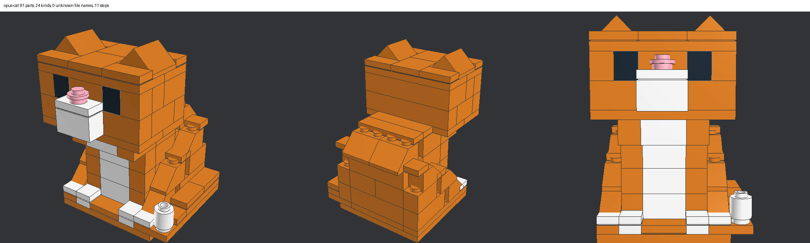
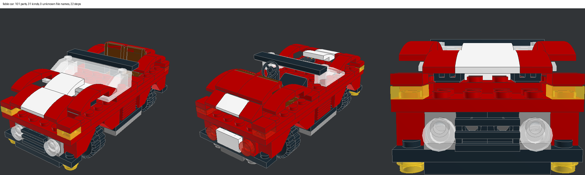
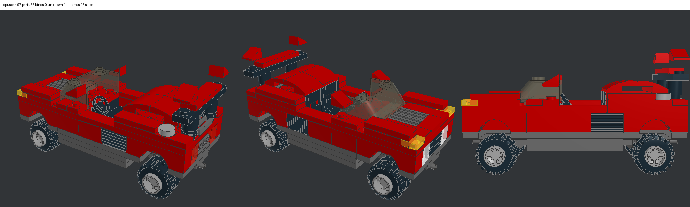

What the pictures show:

- **Recall is not the problem.** Across 472 parts of 67 different kinds, every file name is a real part, and
  they are the right parts: wheel rims and tyres on wheel-holder plates, wheel arches, a windscreen, seats
  and a steering wheel; leaf plates and flower plates; a 6 x 6 round plate held upright on bricks with
  studs on their sides; a jumper plate to centre a nose; inverted slopes to widen a head.
- **The intent is there.** These look like things a person designed: the cat has a collar with a bell,
  the sunflower faces you, Fable's car has a racing stripe over a curved bonnet, arches over its wheels,
  a framed windscreen, head and tail lights and a number plate. Our own pipeline cannot make any of them, because it only knows about fifty
  basic parts and only stacks them.
- **Position is the problem.** The cat's ear tips float above its head; parts at the back of the car hang
  in the air; some neighbours overlap. Nothing told the AI so, and it had one attempt.
- **It takes thought, not tools.** One attempt took between four and twenty minutes of the AI's time;
  Fable's car took the longest and is the best of the six.

## Experiment 2: our own sample models, from pictures

The same one-page instructions, plus a picture of one of our sample models from five sides with a grid on
it (`from-pictures/reference-*.png`), and one sentence: build this. Still no checker and one attempt. This
is the closest test of "an AI that builds what you scanned".

| Model | By | Parts | Kinds | Our pipeline today |
|---|---|---|---|---|
| Blocky cat | Fable 5.2 | 100 | 28 | 130 parts |
| Blocky cat | Opus 5.5 | 92 | 27 | |
| Rubber duck | Fable 5.2 | 151 | 23 | 401 parts |
| Rubber duck | Opus 5.5 | 170 | 17 | |
| Car | Fable 5.2 | 121 | 32 | 342 parts |
| Car | Opus 5.5 | 89 | 27 | |

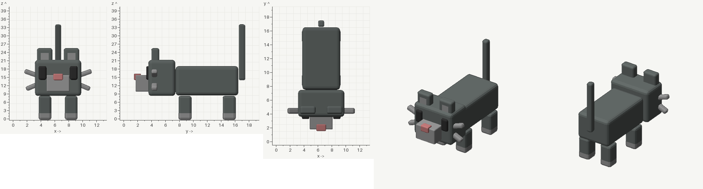
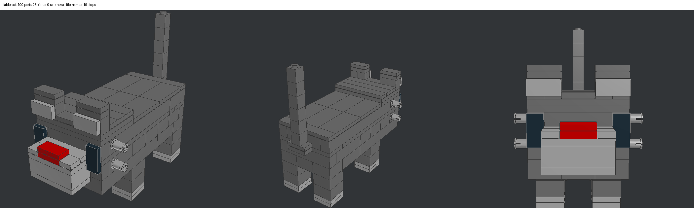
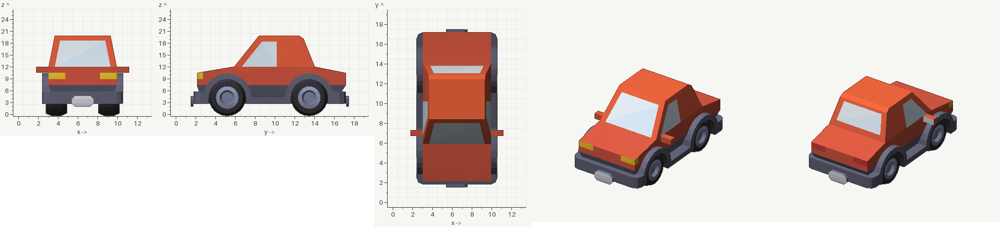
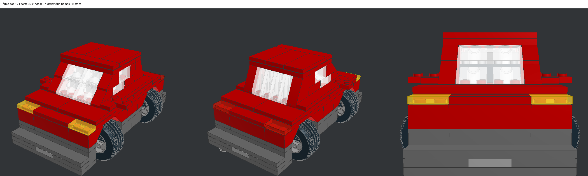
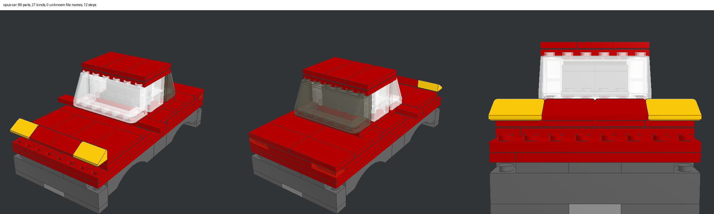
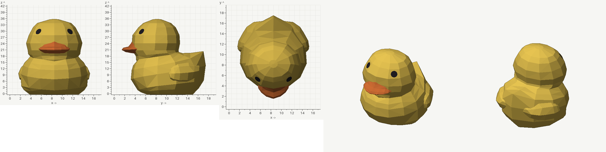
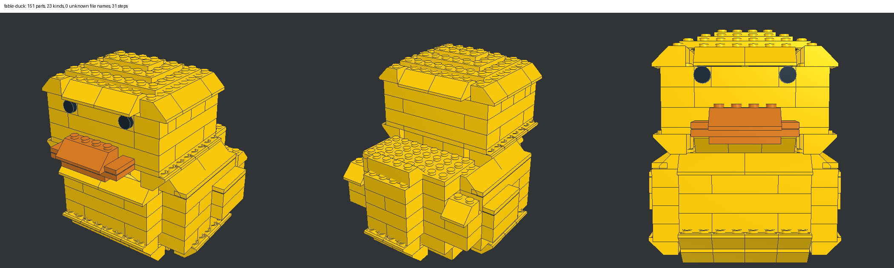
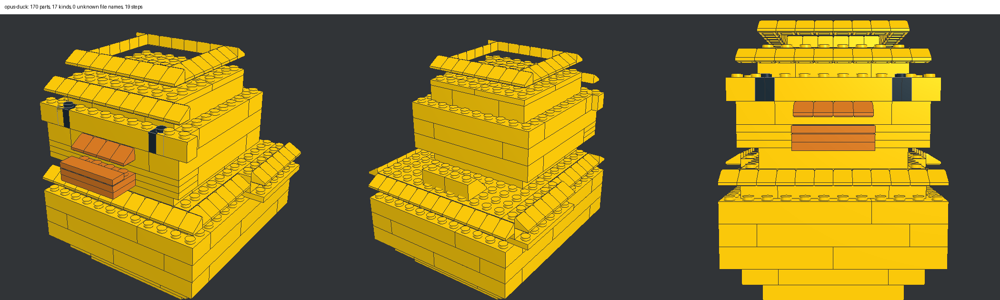

- **Blocky and mechanical things: the AI's build is clearly better than ours.** Fable's cat is the cat in
  the picture with a tiled back, eyes and inner ears on side-stud bricks, and whiskers made of Technic
  pins. Both cars have a chassis, bumpers, real windscreens, lights and wheels on axles, at about a third
  of the parts our pipeline uses, because one shaped part does the work of dozens of small plates.
- **Round, organic things: a different answer, not a better one.** Fable's duck is a chunky, charming
  LEGO duck at 151 parts, with inverted slopes under its belly and round eyes; ours at 401 parts follows
  the real curve far more closely. Opus's duck is a stepped pyramid. Placing hundreds of small slopes by
  hand to follow a curve is exactly the work the solver is good at and the AI is bad at.
- So the two approaches are complements. The plan below keeps the solver as the tool for curved volume.

## Experiment 3: with tools

The same tasks as experiment 1, but now Fable 5.2 has a small workshop, built tonight from the parts
library alone (`bricksnap/lab/` on the branch `wip/Alec-42-free-build`): find parts by description, read
a part's card (size, studs, sockets, a picture), place a part by naming the stud it sits on, check the
model, and look at it from any side. The checker names each problem with the line, the part and the
place, and says how to fix it when it can.

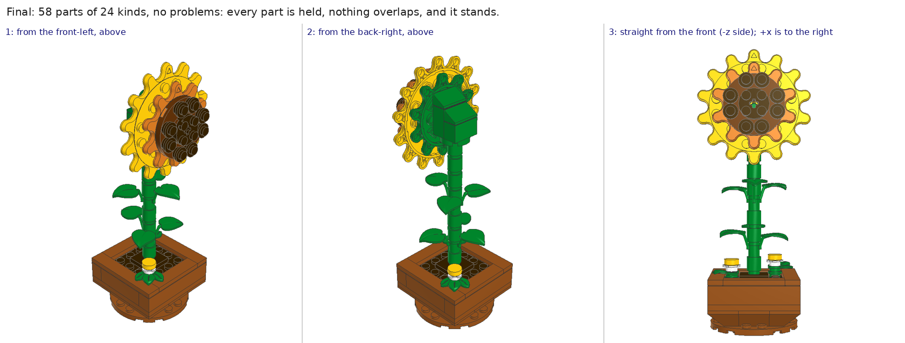
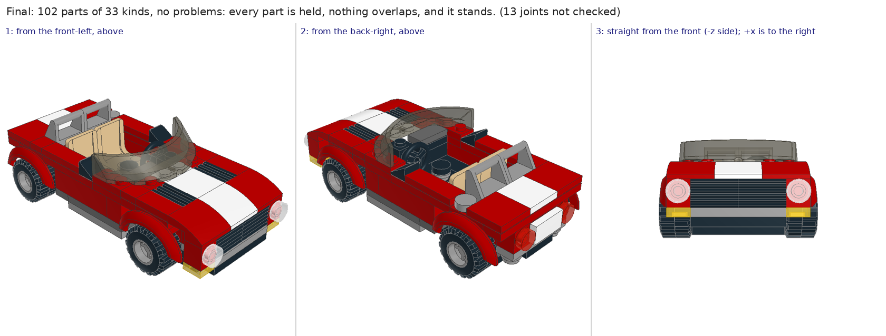
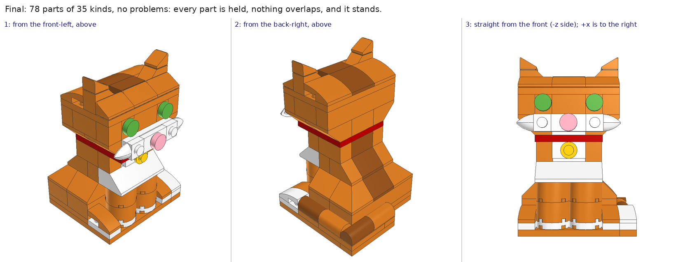

- **The sunflower: 58 parts of 24 kinds, and the checker finds nothing wrong**: every part is held,
  nothing overlaps, and it stands. It took 47 steps and nine minutes; Claude Code reports $3.75 at list
  prices. The model is `with-tools/flower.ldr` and the checker's full report is beside it.
- **The car: 102 parts of 33 kinds, no problems** (13 wheel-pin and tyre joints listed as "not checked").
  82 steps, 21 minutes, $8.11 at list prices (`with-tools/car.ldr`). A red open-top roadster: mudguard
  arches over wheels that turn on wheel-pin plates, a wrap-around smoke windscreen, two tan seats, a
  steering wheel and gear knob, roll bars, a white racing stripe running over curved slopes, round
  headlights, a grille of tiles and a number plate. BrickLink Studio opens it with the same 102 parts
  and 15 steps and names every part.
- **The cat: 78 parts of 35 kinds, and again the checker finds nothing wrong.** 45 steps, twelve and a
  half minutes, $4.35 at list prices (`with-tools/cat.ldr`). An orange tabby with a white bib, green round
  eyes on side-stud bricks, a pink nose, white horn pieces as whiskers, a red collar with a bell, round
  bricks as front legs and a ringed tail of curved slopes wrapped round its side. The no-tools cat had
  ears floating above its head; this one's are held.
Then four more, to test two questions.

| Built | By | Parts | Kinds | Check | Time | List price |
|---|---|---|---|---|---|---|
| Sunflower, from words | Fable 5.2 | 58 | 24 | no problems | 9 min | $3.75 |
| Sitting cat, from words | Fable 5.2 | 78 | 35 | no problems | 13 min | $4.35 |
| Sports car, from words | Fable 5.2 | 102 | 33 | no problems | 21 min | $8.11 |
| Sports car, from words | Opus 5.5 | 108 | 32 | no problems | 17 min | $4.15 |
| Our duck, from pictures | Fable 5.2 | 159 | 30 | no problems | 16 min | $5.96 |
| Our car, from pictures | Fable 5.2 | 137 | 32 | no problems | 16 min | $6.37 |
| Our blocky cat, from pictures | Fable 5.2 | 114 | 32 | no problems | 15 min | $5.01 |

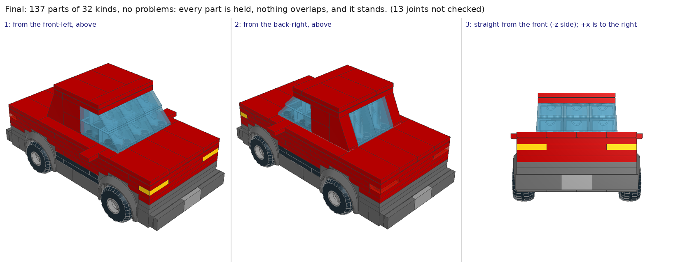
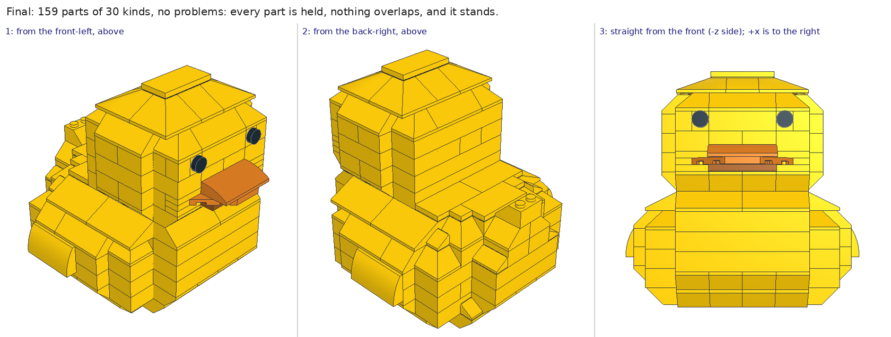
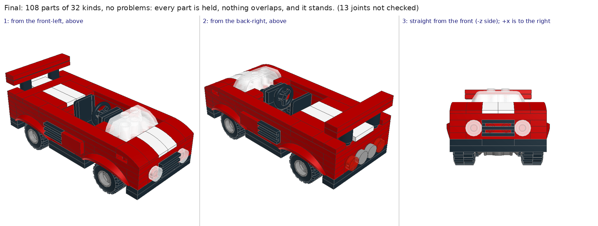

- **Seven sessions, seven models the checker passes.** No session ended with a problem left.
- **From pictures of a real object it works as well as from words.** "Our car" is recognisably the sample
  car, with mudguards over real wheels, a glass windscreen and number plates, in 137 parts; the grid
  pipeline's best version of the same car has 214 parts and wheels built of bricks that do not turn. The duck is a neat, stylised LEGO
  duck with a beak of curved slopes and round eyes; it is still blockier than the solver's.
- **Opus 5.5 does it at half the price.** Its car passes the check and is a good model (spoiler, bubble
  canopy, stripes); Fable's is the more refined of the two. A cheaper builder with Fable as planner and
  critic is the obvious thing to try for cost.

- It is a better design than the no-tools sunflower, because the AI searched: it found real petal plates
  (two sizes, layered), three-leaf plant parts that lock into the stem, and a brick with four side studs
  to hold the head, none of which it had used from memory. The pot tapers on inverted slopes.
- The AI's own closing note lists what it would still improve (a taller pot, a hinge to tilt the head),
  which is the raw material for a critic pass.
- What the checker cannot yet confirm: clips, bars, pins and axles are listed as "not checked" and
  counted as joined, and the strength of a joint is listed but not judged.

## Experiment 4: the two together

The last test of the night joins the two halves. The solver sculpted the duck from the 3D model, as
BrickSnap does today (406 parts, the round body with slopes above and below). That model was handed to
Fable 5.2 in the workshop with the pictures of the real duck and one instruction: keep the body, and make
it a better LEGO model with real parts. The workshop had gained three tools for this: clear everything in
a box, fill a box with interlocked bricks (the solver again, as a tool), and mirror to the other side.

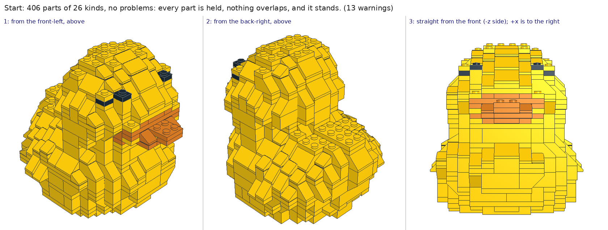
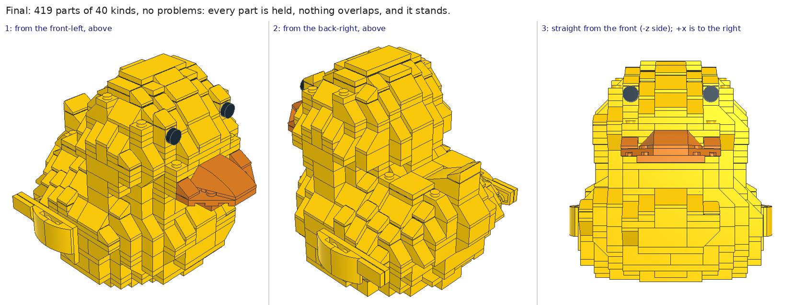

- **419 parts of 40 kinds, and the checker passes it.** 71 steps, 21 minutes, $7.62 at list prices
  (`hybrid/duck.ldr`).
- The body is the solver's. The beak is now a triple-curved orange wedge on a flared plate, locked two
  studs into the head; the eyes are round tiles on side-stud bricks facing forward; each wing is a wing
  plate standing on side studs with curved slopes for a shoulder, built once and mirrored; the tail rises
  in one line; the crown is tiled.
- The workshop's checker, which knows nothing of BrickSnap and reads the shapes of parts straight from the
  LDraw library, also passes all five of BrickSnap's own saved sample builds: a second opinion on the
  solver that had never been asked for before.
- This is the shape of the proposal below in one picture: the solver for volume, the AI for character.

## Experiment 5: more AI on the present system

Before changing anything large, the question Alec asked first: on the grid BrickSnap has today, does it
help to give the AI more of the work? Two ways, the same AI (Fable 5.2), the same three models:

- **One designer**: one AI run touches up the conversion, as before.
- **The studio**, built tonight: six runs, each with one job. Plan; lay out the main shapes from an empty
  grid; refine and colour; surface and details; a critic who has not seen the work; fix what the critic
  listed. Every pass is kept as a version.

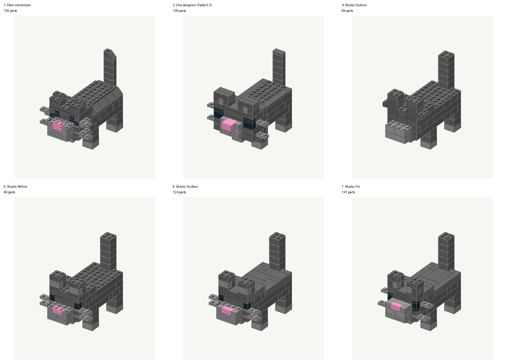
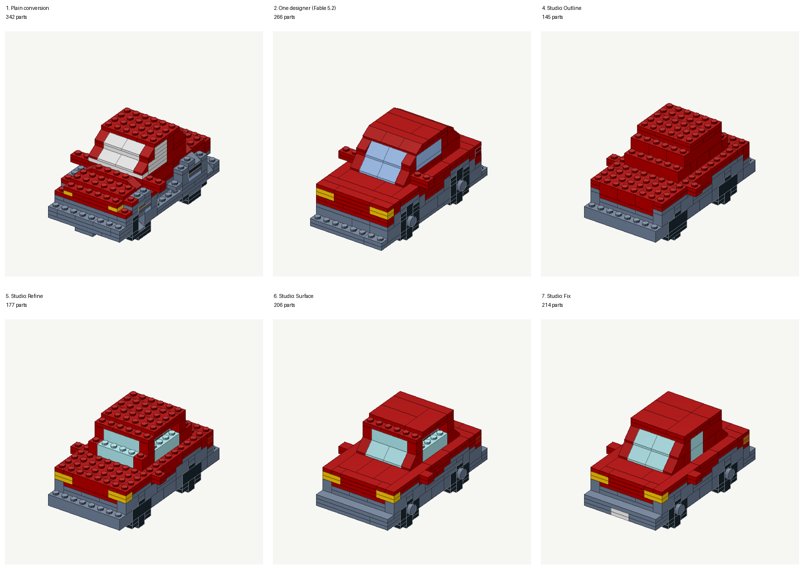
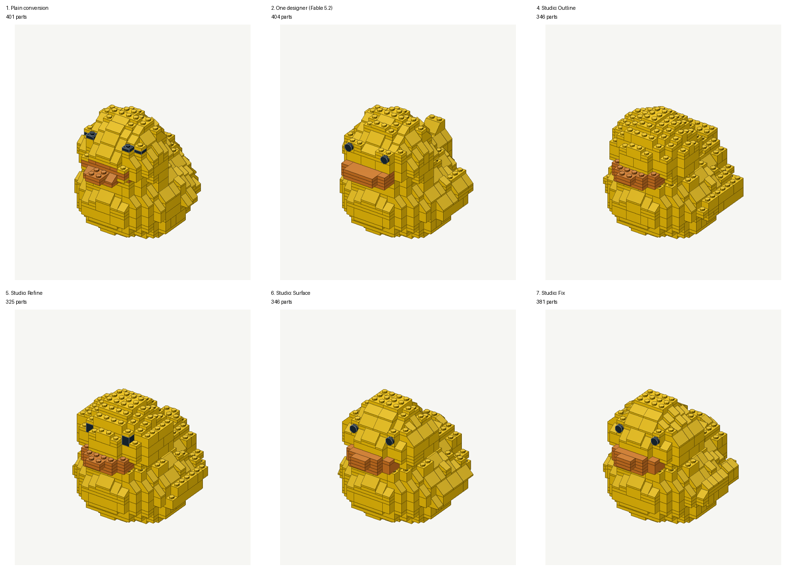

| Model | Plain conversion | One designer | Studio | The blind judge preferred |
|---|---|---|---|---|
| Cat | 130 parts | 139 parts, 5 minutes | 141 parts, 11 minutes, $5.63 | the studio, narrowly: tiled back, truer muzzle; the other has the better head and tail |
| Car | 342 parts | 266 parts, 6 minutes | 214 parts, 10 minutes, $4.96 | the studio: smoother mirrors and bumper, number plate, fewer parts |
| Duck | 401 parts | 404 parts, 4 minutes | 381 parts, 15 minutes, $7.13 | the one designer, "close to a coin toss": cleaner tail and bill, fewer weak spots |

(Dollar figures are what Claude Code reports at list prices; on a subscription they are usage, not a
bill. The one-designer runs' cost was not recorded.)

- **Both are much better than the conversion**, and better than the designs of a few days ago. The
  largest single gain tonight came from the AI model: Fable 5.2 as the one designer gives the car a
  slanted glass windscreen, clean panels and round wheel hubs, and gives the duck round eyes on the sides
  of its head, in one five-minute run.
- **The studio is a modest gain for about three times the time**: cleaner surfaces and fewer parts on the
  blocky models, no gain on the round one. The critic is the most useful pass; its lists were concrete
  ("the windscreen is too upright: one sloped step, then a vertical pane").
- **Neither changes what the model is made of.** Both still come out as stacked bricks with slopes,
  because that is all the grid can express. The sunflower above is a different kind of object.

## What others have found

All three are from the last two months, and all are open source. (Collected by a research agent that
opened each source; the links are at the end. I have not run their code.)

- **BrickNet** (a parts and connections data set): where and how about 14,600 parts connect (studs,
  sockets, pins, bars, clips, hinges, ball joints), and a simplified shape of each part for detecting
  overlaps. In it, a model is built by connection ("this stud into that socket, turned a quarter"). Its
  authors report that when a model predicts positions directly, "build sequences quickly become invalid
  after a small number of steps".
- **BrickAgent** (Stanford and others): an AI with six tools: find a part, describe a part, attach by
  connection, add by position, check, and view. With the checker, every model it finished was valid; without,
  40% (and for a weaker AI, under 1%). Models averaged 217 parts and reached 4,000. The checker tests fit,
  overlap and whether the model stays up under gravity.
- **BrickWright** (CMU and Stanford): the AI writes a short program (add, connect, stack, fill a box,
  nested sub-builds). Placing by connection instead of by position halved the cost and let models grow.
- **What none of them solved: looks.** In the largest study, people preferred a human's design to the
  AI's in 323 pairs out of 360. Every one of these systems starts from a sentence, not from an object,
  and none has a design process: one agent, one pass.

How LEGO's own designers work, from interviews: fix the size or the part count first; let one key part
decide the scale (a windscreen, a wheel); make several quick sketch models and choose; build the structure
before the skin; split the model into sections so a change stays local; build sideways where the shape
needs it; test that it holds; and have a separate team rebuild it from scratch to plan the steps.

How the agent swarms that build cities in Blender are organised, as far as could be found: one lead agent
writes a single layout file with every number in it; each agent gets one module and an agreed interface;
each renders its own previews; a mechanical checker and separate reviewer agents judge the result, because
"builders never grade their own work".

## What follows: the design

**The AI builds; the software is its workshop.**

1. **The model is a set of real parts, grouped into named sub-assemblies** (head, body, wheel, flower
   head), exactly as a LEGO designer thinks and as building instructions are laid out. This replaces the
   grid of coloured cells as the thing the AI works on.
2. **The tools**, few and exact:
   - *find parts* by description ("leaf", "wing 2 x 4 left", "wheel holder") and by shape and size ("about
     6 x 4 studs, curved top"), which is Alec's "best matching" pass; each answer shows the part, its size
     and where it connects;
   - *attach* a part by naming the connection, so the AI never works out a position;
   - *fill* a volume with interlocked bricks and a finished surface. This is everything BrickSnap does
     today, kept as one tool: the solver builds the structural core and large plain surfaces, where
     choosing parts one by one would be a waste of the AI;
   - *copy and mirror* a sub-assembly;
   - *check*: every connection real, nothing overlapping, nothing loose, the model stands, every part
     made in that colour; each problem named with the part and the place;
   - *look*: pictures from any side, cut through, zoomed, and beside the object it is meant to be.
3. **The method**, taken from how designers work, each step a separate AI run with one job:
   plan (what is it, how big, which key part sets the scale, which sub-assemblies, which colours, is
   there an interior) → sketch (two or three quick rough versions, a judge who cannot tell them apart
   picks one) → structure (the core and how sub-assemblies attach) → sub-assemblies (one agent each, in
   parallel, each given its space and its attachment points) → skin and details → a critic who has not
   seen the work compares it with the object → fixes → building steps.
4. **Every stage is kept as a version**, so two can be compared and an earlier one brought back.
5. **Starting points**: a 3D model or scan (the AI is shown it from all sides and measures against it),
   a photo, or words alone. The object stops being required; it becomes the reference when there is one.
6. **Variety** comes from the plan, not from chance: asking for two or three different interpretations at
   the sketch stage, each with its own key part and style, and letting a judge or the person choose.

## What it costs

List prices as Claude Code reports them; on a subscription they are usage, not a bill.

| Way | AI time | List price | What you get |
|---|---|---|---|
| One designer on the grid | 4 to 6 min | not recorded (one or two studio passes' worth) | a cleaner sculpture |
| The studio on the grid, six passes | 10 to 15 min | $5 to $7 | a slightly cleaner sculpture, every pass kept |
| Built from parts with tools, Fable 5.2 | 9 to 21 min | $3.75 to $8.11 | a model of real, varied parts that the checker passes |
| The same with Opus 5.5 | 17 min | $4.15 | the same kind of model, a little less refined |
| The solver's body plus real parts (the duck) | 21 min | $7.62 | a faithful round body with real features |

Where the money goes, and how to spend less: most of it is the AI re-reading its growing conversation at
every step, and looking at pictures. A cheaper AI as the builder with Fable only to plan and to criticise;
placing several parts in one step; showing a part's picture once and remembering it; and not drawing three
views when one will do would each cut it. None of that has been tried yet.

## The path from here, in order

1. **The workshop in the web app**, marked experimental: describe it, optionally point at one of your
   models, and get a checked model to turn round and download. Done on the night of the study.
2. **A complete checker.** Today it proves studs and overlaps and counts clips, bars, pins and axles as
   joined without proof. Open tables of how every part connects exist (see below); adopting one is a new
   dependency and needs a decision. Add how strong each joint is, whether the model stays up when lifted,
   and the colours each part is really made in.
3. **Seeing and building it properly**: a 3D view that draws any part, building steps and a booklet for
   these models, and a parts list with BrickLink numbers and a wanted list.
4. **The design process on top**, reusing the studio and versions built tonight: plan, sub-assemblies
   (one agent each, side by side), a critic who has not seen the work, fixes; two or three sketches and a
   judge at the start, for variety.
5. **The solver as a tool, by default for scans**: sculpt the body from the 3D model, then rebuild its
   features with real parts, as the duck was.

## What it would change in BrickSnap

- Kept: the web app, versions, the blind judge, the run of passes, the solver and finishing pass (as the
  fill tool), the instruction booklet's layout, the parts list and wanted list.
- New: a connection table for the whole parts library; snapping and a checker that work for any part in
  any direction; pictures and a 3D view that draw any part; colours each part is really made in.
- The accepted decisions "a 3D model is always the starting point" and "the AI never places parts" would
  be replaced. The second was made to guarantee that models hold together; the guarantee moves from the
  solver to the checker.

## Where this stands

- Done tonight: the five experiments above; the studio and versions are in the product (`main`); the
  workshop for free building is on a branch.
- Also done: the workshop is in the web app and the command line as an experimental second way to make a
  model ("Describe it and let the AI build it"; `bricksnap make`). The eight models from experiments 3 and
  4 are in Alec's own list of models there.
- Not started: more than one agent on one model; models above 200 parts; the solver as a fill tool inside
  the workshop; a 3D view that can draw any part.

## Sources

BrickNet: https://github.com/kulits/BrickNet · BrickAgent and BrickBench: https://arxiv.org/html/2610.12452,
https://github.com/kulits/BrickAgent · BrickWright and BrickLayer: https://arxiv.org/html/2610.31651 ·
BrickGPT: https://arxiv.org/html/2505.05469 · LDCad shadow library (connections, CC BY-SA 4.0):
https://github.com/RolandMelkert/LDCadShadowLibrary · LDraw parts library (CC BY):
https://library.ldraw.org · LEGO designers: https://brickset.com/article/22968,
https://www.lego.com/en-us/service/help-topics/article/how-we-design-our-building-instructions,
https://bricknerd.com/home/snot-basics-geometry-techniques-and-pitfalls-3-18-2021 · agent swarms:
https://www.anthropic.com/engineering/building-c-compiler, https://github.com/PhiloLabs/fable51-worlds
