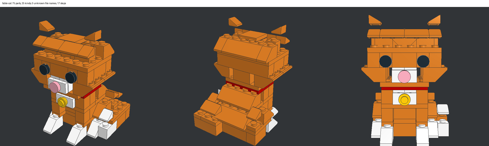
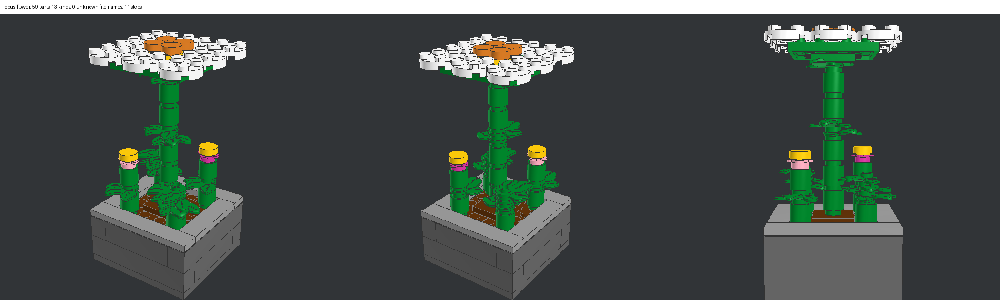

# Can the AI build the whole thing? A design study

Written on the night of 19 November 2026 by Alec's agent, after Alec tried the web app and asked whether
the AI could do far more: choose from every kind of part, build interiors, work as several agents, even
start from words alone ("just make me a cat"). This file records what was tested, what others have found,
and what follows from it. Pictures and the models themselves are in the folders beside it. Results are
added below as each experiment finishes; the section "Where this stands" at the end says what is done.

## The short answer

Yes. The two fears were that there are too many pieces to recall, and that nobody knows what to break a
model down into. The first turned out not to be the obstacle: asked to write a model straight out as a
list of real parts, with no tools at all, both Fable 5.2 and Opus 5.5 used only part numbers that exist,
and chose them with intent (wheels on holder plates, a steering wheel, leaf plates, side-stud bricks for a
flower that faces forward). What they get wrong is exact position: a few parts float or overlap. Three
research groups published the same finding within the last two months, and the cure they all report is
the one we already believe in: the AI places a part by saying what it connects to, software works out the
position, and a checker says exactly what is wrong.

So the proposal is to turn BrickSnap around. Today the software builds and the AI touches up. Instead the
AI builds, the way a LEGO designer does, and the software is its workshop: it finds parts, snaps them
together, fills the boring volume, checks everything, and draws pictures.

## What Alec asked, in his words

- "It would be great if AI could do it all, but I don't know if AI is able to recall all the blocks, and
  keep a context over the whole thing and have something to build towards."
- "I want AI to be able to call a specific leaf, a specific wing piece, a specific rod or peg."
- "If we had a skeleton and then had AI fill it in... or AI best-guessed 'there should be a piece that
  looks sort of like this here', and then another pass of best matching."
- "Interiors, so they aren't just full." "Different blocks rather than the simple ones."
- "This is turning into an agent orchestration loop... not simply prompting: giving AI tools, maybe a
  method." "If we fix it into doing the same thing, will they all come out looking the same?"
- "I don't want the final product to be super expensive to make a model, but I want the best possible
  thing. I'm willing to compromise anything to get that."

## Experiment 1: no tools at all

Each AI was given one page of instructions on the LDraw file format (`no-tools/instructions-given.md`)
and one sentence saying what to build. No reference model, no parts list, no pictures, no checker, one
attempt. The answers were drawn with LeoCAD, a free program that knows the real shape of every part.

| Asked for | By | Parts | Kinds of part | Part numbers that do not exist |
|---|---|---|---|---|
| A sitting cat, about 80 parts | Fable 5.2 | 75 | 25 | none |
| A sitting cat, about 80 parts | Opus 5.5 | 81 | 24 | none |
| A small sports car with turning wheels, arches, windscreen, seat and steering wheel, about 110 parts | Opus 5.5 | 97 | 33 | none |
| A potted flower in the Botanicals style, about 60 parts | Fable 5.2 | 59 | 14 | none |
| A potted flower in the Botanicals style, about 60 parts | Opus 5.5 | 59 | 13 | none |

What the pictures show:

- **Recall is not the problem.** Across 371 parts of 62 different kinds, every file name is a real part, and
  they are the right parts: wheel rims and tyres on wheel-holder plates, wheel arches, a windscreen, seats
  and a steering wheel; leaf plates and flower plates; a 6 x 6 round plate held upright on bricks with
  studs on their sides; a jumper plate to centre a nose; inverted slopes to widen a head.
- **The intent is there.** These look like things a person designed: the cat has a collar with a bell,
  the sunflower faces you. Our own pipeline cannot make any of them, because it only knows about fifty
  basic parts and only stacks them.
- **Position is the problem.** The cat's ear tips float above its head; parts at the back of the car hang
  in the air; some neighbours overlap. Nothing told the AI so, and it had one attempt.

## What others have found

All three are from the last two months, and all are open source. (Collected by a research agent that
opened each source; the links are at the end. I have not run their code.)

- **BrickNet** (a parts and connections data set): where and how about 14,600 parts connect (studs,
  sockets, pins, bars, clips, hinges, ball joints), and a simplified shape of each part for detecting
  overlaps. In it, a model is built by connection ("this stud into that socket, turned a quarter"). Its
  authors report that when a model predicts positions directly, "build sequences quickly become invalid
  after a small number of steps".
- **BrickAgent** (Stanford and others): an AI with six tools: find a part, describe a part, attach by
  connection, add by position, check, and view. With the checker, every model it finished was valid; without,
  40% (and for a weaker AI, under 1%). Models averaged 217 parts and reached 4,000. The checker tests fit,
  overlap and whether the model stays up under gravity.
- **BrickWright** (CMU and Stanford): the AI writes a short program (add, connect, stack, fill a box,
  nested sub-builds). Placing by connection instead of by position halved the cost and let models grow.
- **What none of them solved: looks.** In the largest study, people preferred a human's design to the
  AI's in 323 pairs out of 360. Every one of these systems starts from a sentence, not from an object,
  and none has a design process: one agent, one pass.

How LEGO's own designers work, from interviews: fix the size or the part count first; let one key part
decide the scale (a windscreen, a wheel); make several quick sketch models and choose; build the structure
before the skin; split the model into sections so a change stays local; build sideways where the shape
needs it; test that it holds; and have a separate team rebuild it from scratch to plan the steps.

How the agent swarms that build cities in Blender are organised, as far as could be found: one lead agent
writes a single layout file with every number in it; each agent gets one module and an agreed interface;
each renders its own previews; a mechanical checker and separate reviewer agents judge the result, because
"builders never grade their own work".

## What follows: the design

**The AI builds; the software is its workshop.**

1. **The model is a set of real parts, grouped into named sub-assemblies** (head, body, wheel, flower
   head), exactly as a LEGO designer thinks and as building instructions are laid out. This replaces the
   grid of coloured cells as the thing the AI works on.
2. **The tools**, few and exact:
   - *find parts* by description ("leaf", "wing 2 x 4 left", "wheel holder") and by shape and size ("about
     6 x 4 studs, curved top"), which is Alec's "best matching" pass; each answer shows the part, its size
     and where it connects;
   - *attach* a part by naming the connection, so the AI never works out a position;
   - *fill* a volume with interlocked bricks and a finished surface. This is everything BrickSnap does
     today, kept as one tool: the solver builds the structural core and large plain surfaces, where
     choosing parts one by one would be a waste of the AI;
   - *copy and mirror* a sub-assembly;
   - *check*: every connection real, nothing overlapping, nothing loose, the model stands, every part
     made in that colour; each problem named with the part and the place;
   - *look*: pictures from any side, cut through, zoomed, and beside the object it is meant to be.
3. **The method**, taken from how designers work, each step a separate AI run with one job:
   plan (what is it, how big, which key part sets the scale, which sub-assemblies, which colours, is
   there an interior) → sketch (two or three quick rough versions, a judge who cannot tell them apart
   picks one) → structure (the core and how sub-assemblies attach) → sub-assemblies (one agent each, in
   parallel, each given its space and its attachment points) → skin and details → a critic who has not
   seen the work compares it with the object → fixes → building steps.
4. **Every stage is kept as a version**, so two can be compared and an earlier one brought back.
5. **Starting points**: a 3D model or scan (the AI is shown it from all sides and measures against it),
   a photo, or words alone. The object stops being required; it becomes the reference when there is one.
6. **Variety** comes from the plan, not from chance: asking for two or three different interpretations at
   the sketch stage, each with its own key part and style, and letting a judge or the person choose.

What this costs per model is measured in the experiments below. The published systems report between a
few cents and a few dollars for 20 to 220 parts with one agent.

## What it would change in BrickSnap

- Kept: the web app, versions, the blind judge, the run of passes, the solver and finishing pass (as the
  fill tool), the instruction booklet's layout, the parts list and wanted list.
- New: a connection table for the whole parts library; snapping and a checker that work for any part in
  any direction; pictures and a 3D view that draw any part; colours each part is really made in.
- The accepted decisions "a 3D model is always the starting point" and "the AI never places parts" would
  be replaced. The second was made to guarantee that models hold together; the guarantee moves from the
  solver to the checker.

## Where this stands

- Done: experiment 1 (above); the research; this proposal.
- Running: the same three tasks with tools (find, attach, check, look); building our own sample duck, cat
  and car from pictures; the multi-pass design on the present grid, for comparison.
- Not started: more than one agent on one model; models above 200 parts.

## Sources

BrickNet: https://github.com/kulits/BrickNet · BrickAgent and BrickBench: https://arxiv.org/html/2610.12452,
https://github.com/kulits/BrickAgent · BrickWright and BrickLayer: https://arxiv.org/html/2610.31651 ·
BrickGPT: https://arxiv.org/html/2505.05469 · LDCad shadow library (connections, CC BY-SA 4.0):
https://github.com/RolandMelkert/LDCadShadowLibrary · LDraw parts library (CC BY):
https://library.ldraw.org · LEGO designers: https://brickset.com/article/22968,
https://www.lego.com/en-us/service/help-topics/article/how-we-design-our-building-instructions,
https://bricknerd.com/home/snot-basics-geometry-techniques-and-pitfalls-3-18-2021 · agent swarms:
https://www.anthropic.com/engineering/building-c-compiler, https://github.com/PhiloLabs/fable51-worlds
