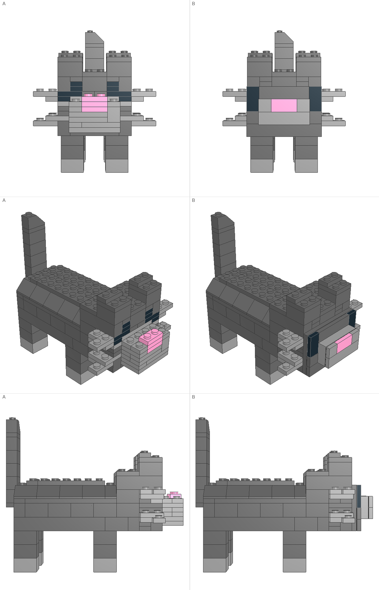
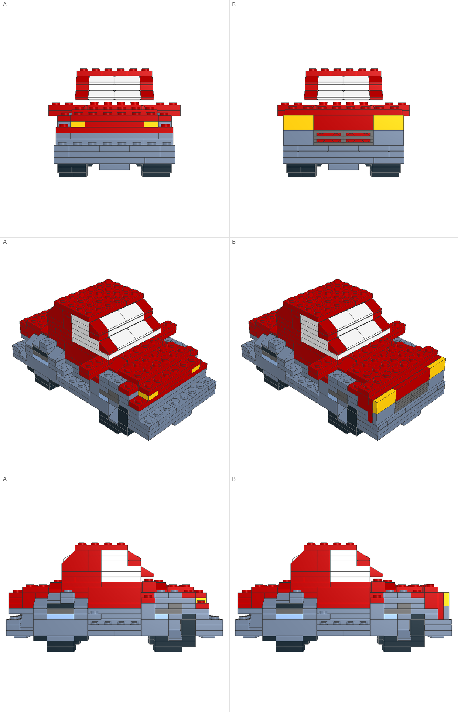
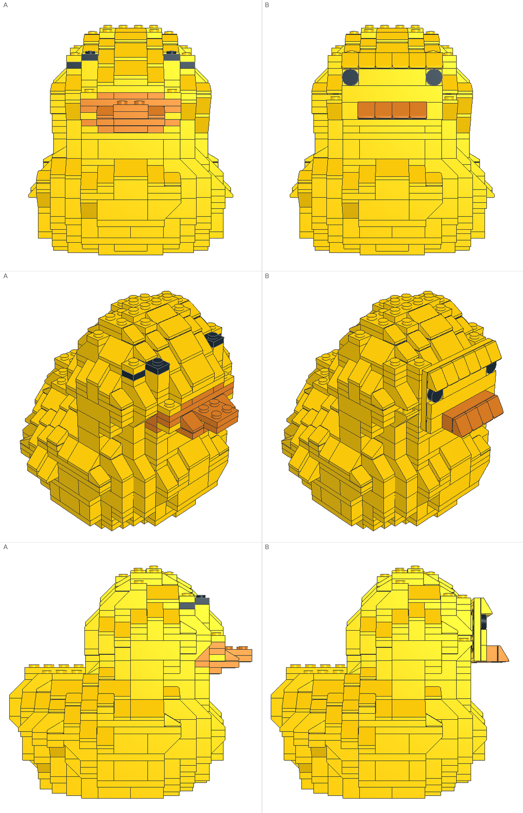

# Experiment 4: one sideways face on a converted model

*2026-11-20. Built by hand by Claude (Fable 5.2), working with the AI builder's own tools. No AI build,
no AI designer and no `claude` process was started.*

## The question

BrickSnap's converter stacks bricks with their studs up, so a face (a cat's face, a car's nose) comes
out as steps of stacked plates. Official sets of this size build a face flat, as a panel of tiles and
slopes on a plate, and press it sideways onto bricks with studs on their sides: would one such face,
put on a model the converter has already made, look clearly better?

## The pictures

Each sheet shows the same model twice, from the same three cameras at the same scale: the face straight
on, three-quarter from the front-left above, and the left side. One version is labelled A and the other
B. Which is which is given further down, under "Which is which", so that the sheets can be shown to
someone who has not read this page. Look at them before reading on.

**Cat**

**Car**

**Duck**

---

## Which is which

**On every sheet A (left) is the converter's model and B (right) is the one with the hand-built face
panel.** Everything outside the face is the converter's, part for part.

## The "before" models

The three saved showcase projects in `samples/projects/` (`cat-showcase`, `car-showcase`,
`duck-showcase`) hold the AI designer's finished version as `build.ldr`, not the plain conversion, and
`cat-designed` is also a designer run. So the "before" here is the plain conversion made fresh from the
same model files at the same size: `bricksnap new samples/models/<cat|car|duck>.glb --studs 16`, with the
engine as it is on `main` today (commit e48ee30). Nobody changed it. Each was loaded into a work folder
the way the AI builder gets a starting model (`bricksnap.lab.run.prepare` with a start model: moved so
its middle is at x = 0, checked as attempt 0), and every change was made with
`bricksnap.lab.tools.call_tool`, the same calls the AI builder makes.

## What was done, subject by subject

### Cat: the face of the head (one attempt, then one fix)

- **Cleared:** the muzzle and the front row of the head below the forehead (one `remove_box`, 32
  parts: the stacked light grey muzzle, the pink nose, the black eye plates). Two black eye plates in
  the forehead row were remade dark grey.
- **Mount:** one 1 x 4 brick with four studs on its side (30414), standing on the free front studs of
  a 2 x 4 plate that is woven into the head's lower layers. It sits in the hole left by the old front
  row.
- **Panel:** a 6 x 4 plate (3032) pressed onto the four side studs, covering the whole front of the
  head (6 studs wide, 10 plates tall). On it: two tall black eyes (1 x 2 tiles), dark grey tiles round
  them, and a muzzle that is a 2 x 4 light grey brick built out from the panel, faced with light grey
  tiles and a pink 1 x 2 tile for the nose. The converter's whiskers were left as they were.
- **Fix:** the first version left four holes at the head's front corners, visible from the side
  (clearing the box had taken the corner columns too). Four 1 x 1 dark grey bricks filled them.
- **Could not do:** put the nose on top of the muzzle, as the reference has it. The muzzle's top is the
  side of a brick and has no studs; the nose went on the front instead.

### Car: the nose (one attempt)

- **Cleared:** the red front row above the bumper (5 parts: the hood's front edge and the two yellow
  headlight plates).
- **Mount:** two 1 x 4 side-stud bricks (30414) end to end across the whole 8-stud nose, standing on
  the converter's grey plates below, capped by a 1 x 8 red plate that ties them together and brings
  the hood back to its height. That is what the guide's vehicle playbook says: a side-stud brick across
  each end.
- **Panel:** a 2 x 8 red plate (3034) on all eight side studs. Top row: a yellow 1 x 2 tile at each end
  for the headlights, red tiles between. Bottom row: two grille tiles (2412b) in the middle, grey tiles
  at the sides.
- **A real collision, fixed:** the panel's bottom edge first sat on the studs of the bumper's top row
  (the checker said so, correctly). The bumper's top plates were swapped for tiles of the same size,
  and its one long 2 x 6 plate for a 2 x 4 plate plus a 2 x 2 tile, so that nothing pokes up under the
  panel.
- **Not done:** the tail. One face per subject, as the question asks.

### Duck: the face of the head (two attempts, then one fix)

- **Cleared:** the beak and the front of the round head between the neck and the crown (one
  `remove_box`, 38 parts, plus one orange plate under the beak that was left hanging). The converter's
  black eye plates on top of the head, and two orange plates left under the face, were remade yellow.
- **Mount:** two 1 x 2 brackets (99780) on the free front studs of a 2 x 6 plate inside the head. A
  bracket's side studs line up with the plate lines (a side-stud brick's are half a plate off), and here
  that made the panel's edges meet the layers above and below exactly.
- **Panel:** a 6 x 4 yellow plate (3032) on the four bracket studs.
  - *Attempt 1:* two round black tiles for eyes at the top corners, yellow tiles, and a beak of two
    orange 1 x 4 bricks stacked out from the panel with an orange tile on the end. It read as a duck from
    the front, but the beak was a long square stick and the flat panel stood like a board in front of a
    round head (kept as `experiment-4/duck-after-try1.ldr`).
  - *Attempt 2 (the one pictured):* the top row of the panel made of six small 1 x 1 slopes, to round its
    top edge back into the head; the eyes moved down a row; the beak shortened to one orange brick with
    four 1 x 1 slopes on its end, so that its tip tapers like a bill.
- **Fix:** gaps between the panel and the head, visible from the side, filled with eight small yellow
  bricks and plates behind the panel's edges.
- **Could not do:** make a round face. A panel is flat; the only rounding available on its edge is
  slopes that lean back by one plate. The beak, which in the reference is a flat wide shape pointing
  forward, can only be built outward from a sideways panel as a stack of brick sides, so it comes out as
  a block or a row of slopes rather than a bill.

## The counts

| | Cat | Car | Duck |
|---|---|---|---|
| Parts before | 132 | 345 | 404 |
| Parts after | 117 | 352 | 394 |
| Change | −15 (−11%) | +7 (+2%) | −10 (−2.5%) |
| Parts removed | 32 | 10 | 44 |
| Parts added | 17 | 17 | 34 |
| Side studs the panel hangs on | 4 (one row) | 8 (one row) | 4 (one row) |
| What holds those studs | one 1 x 4 side-stud brick | two 1 x 4 side-stud bricks | two 1 x 2 brackets |
| Panel plate | 6 x 4 | 2 x 8 | 6 x 4 |
| Tool calls | 27 | 22 | 49 (both attempts) |
| Of which `place` | 14 | 13 | 27 |
| `look` and `check` | 4 and 2 | 3 and 1 | 9 and 3 |
| Minutes from first to last call | about 13 | about 3 | about 6 |

Removed and added count a part once for each line that differs; a part remade in another colour counts
as one removed and one added (cat 2, duck 6).

**Kinds of part added.**

- Cat: side-stud brick 1 x 4 (30414); plate 6 x 4 (3032); brick 2 x 4 (3001) for the muzzle; tiles
  1 x 1, 1 x 2, 1 x 4, 1 x 6 (3070b, 3069b, 2431, 6636); and to refill, plate 1 x 1 (3024) and brick
  1 x 1 (3005).
- Car: side-stud brick 1 x 4 (30414); plate 1 x 8 (3460) as the cap; plate 2 x 8 (3034) as the panel;
  grille tile 1 x 2 (2412b); tiles 1 x 2, 1 x 4, 2 x 2 (3069b, 2431, 3068b); plate 2 x 4 (3020) to replace
  the long bumper plate.
- Duck: bracket 1 x 2 - 1 x 2 up (99780); plate 6 x 4 (3032); slope 1 x 1 (54200); round tile 1 x 1
  (98138); brick 1 x 4 (3010) for the beak; tiles 1 x 1, 1 x 4, 1 x 6; and to refill and recolour,
  ordinary bricks and plates (3005, 3024, 3023b, 3710, 3666).

**The tool calls** do not include the reading aids I wrote for myself to see inside the model (a part
list with each part's extent, and a cross-section printed as a grid; about four uses per subject). An AI
builder has no such view: it would have to find the same things from `model` and `part_info`, which
would have cost it many more calls. Several calls went on getting a part to face the right way: the
cat's muzzle and the car's panel each went on upward first and had to be put on again with another
socket, and the duck's slopes first faced down.

## What the checker said

**Before.** Cat and car: no problems. Duck: one problem and fourteen warnings, all the converter's and
all unchanged in the "after": one 1 x 1 slope on an inverted slope reported as loose (line 371; the
converter's own check passes it, and I did not look into which is right), and fourteen warnings that
the inverted slope's part number 3665 is an old one.

**After, as pictured.**

- Cat: "117 parts of 26 kinds, no problems: every part is held, nothing overlaps, and it stands."
- Car: "352 parts of 27 kinds, no problems: every part is held, nothing overlaps, and it stands."
- Duck: "394 parts of 34 kinds, 1 problem, 14 warnings": the same converter problem and warnings as
  before, nothing new.

**Known false kinds** (curved slopes over a plate's end, plates beside a bracket's flange; see
`experiments.md`): none came up. No curved slopes were used. The duck's brackets stand on a plate with
nothing beside their flanges.

**Real faults the checker found while I built:** one. The car's panel at first rested its bottom edge
on the bumper's studs ("they push into the side or top of line 424"). It was right, and I fixed it (see
the car).

**Real faults the checker cannot see:** holes left by clearing a box, visible from the side (cat and
duck). They are not about holding or collisions, so no check reports them; they showed up only in the
`look` pictures. Fixed.

**Weaker joints the change made.** On the cat, a 1 x 2 forehead brick and a hidden 1 x 2 plate are now
held by one stud each where the stacked muzzle used to wedge them in from below. The report lists them
among the single-stud parts; neither carries much. The panels hang on one row of studs (4, 8 and 4). In
a real build that row is the hinge a panel could be levered off, and the sets we read usually have two
rows, or a bracket at the edge.

---

## My verdict, subject by subject

Read this after forming your own view from the sheets.

- **Cat: better, clearly from the front and the three-quarter view, the same from the side.** The
  converter's face is a busy stack of thin light grey plates with eyes half buried in the layers. The
  panel gives a calm, flat face with two clear eyes and a muzzle that reads as one piece, like a toy
  someone designed. What it lost is the pink nose on top of the snout, and a seam where the panel
  meets the head is visible from the side. The cat's head is a box with a flat front, the case the
  method is made for.
- **Car: a little better head on, a little worse in profile; about the same overall.** Head on, B is
  more plainly a car's front: headlights and a grille. But the panel brings the top of the nose
  forward by most of a stud, so the profile is blunter; the headlights are big (2 studs each); and
  the red panel's edge shows as a red strip down the grey lower body. The converter's nose, with
  small yellow lights in a red band, is already readable at this size.
- **Duck: worse.** From the front the eyes are clearer, but the four orange slopes of the beak read as
  teeth, and the face is a flat mask. From the three-quarter view and the side it is plainly a board
  stuck onto a round head. The converter's stacked beak is a better duck bill, because a bill is
  flat and points forward, which is what studs-up building does well. Two attempts did not fix it, and
  I do not think a third would: one flat panel cannot sit well on a round head.

So by my eye: one clearly better, one about the same, one worse. The experiment's own bar (a blind judge
prefers the panel on at least two of three) is not met by my judgement, but I made the panels, so my
judgement should count for less than a blind one.

## What this says about the converter leaving side studs for a face

**Where it works.** On a flat end of a boxy shape: a box head (the cat), the end of a vehicle (the
car), and presumably a robot's chest or a building's front. It did not work on a round head (the
duck). A round head is where the sets use a whole core with a panel on every face, rounded with curved
slopes (the guide's creature playbooks), and that is not "one face".

**How big a face has to be.** Both faces that came out well or neutral were at least 6 studs wide and
had room for two rows of studs (a 6 x 4 or 2 x 8 plate). Two rows is the smallest panel that holds
eyes beside a muzzle, or lights above a grille. Below about 4 by 2 studs a panel holds one or two tiles,
and a single detail on one side-stud brick, which the converter can already place, does the same job.

**What the body has to offer.**

1. A row of free studs on a plate set back from the face by the panel's depth, with room above it for a
   side-stud brick (3 plates) or a bracket (2.5 plates). The cat had a 2 x 4 plate in the right place,
   the car its grey layer under the hood, the duck a 2 x 6 plate inside the head. In each case the plate
   ran back into the body, which is what ties the mount in.
2. About 16 LDU (0.8 of a stud) of clear depth in front of the mount for the plate and its tiles, plus
   whatever is built out from the panel. Where the converter leaves no such room the face moves forward:
   the car's nose grew by 0.8 of a stud at the top.
3. Its side columns kept. Clearing a box took the head's corner columns as well, and the holes showed
   from the side. A converter that leaves a face patch must keep the outline at the patch's edges and
   leave only the middle open.
4. Nothing sticking up right under the panel's edges. The car's bumper studs met the panel: the strip
   under a panel needs tiles.

**Half a plate.** A side-stud brick's studs sit 10 LDU below its top, so a panel on it has its edges
half a plate off the body's layers, as the guide's Panels paragraph says. It happened not to matter on
the cat and the car, because the panel's edges fell against plain body. On the duck, where the panel
had to meet layers above and below, the bracket (whose side studs line up) was the better mount.

**What went wrong, in order of how much it cost.** (1) A flat panel on a round head, which no amount of
fiddling fixed. (2) Holes left by clearing, which no check reports. (3) Getting each sideways part to
face the right way: turns and sockets on a side stud took a second try three times. (4) A real collision
with studs under the panel's edge. (5) Recolouring is a remove plus an `add` with typed coordinates;
there is no tool for it.

**What the converter would actually need**, if the owner judges the cat worth it: when the designer
marks a flat face patch at least 6 by 4 studs on a boxy region, the solver leaves the front column of
that patch empty (keeping its edge columns), stands a row of side-stud bricks or brackets on a plate
that runs back into the body, tiles any studs directly under the patch, and records the patch and its
studs. Building the panel itself is design work, and every decision above (where the eyes go, what the
muzzle is) was a design decision. It belongs with the designer or the AI builder, not the solver. This
is the "mounts, not panels" step the README proposes, and this experiment does not argue for more than
that.

## What I would try next

1. **Show the three sheets blind** to two or three people, with the question "which looks more like a
   finished set?" That is the judgement this experiment was for.
2. **One more boxy subject**: the car's tail, or a model with a big flat front (the knight's chest, a
   robot), to see whether the cat is the rule or the exception. About 25 tool calls each.
3. **The duck with a head of its own**: rebuild the whole head as a core with a panel on the front and
   both sides, curved slopes at the corners, as the creature playbook says. That is no longer "one face",
   but it is the honest test for round subjects.
4. **Two small tools would have saved about a third of the calls**: a way to recolour parts in place,
   and a cross-section view (what is in this layer of the model) for finding where a mount can stand.

## Files

All in `experiment-4/`; every `.ldr` opens in BrickLink Studio or LeoCAD. Lines starting `0 removed:`
are comments that keep the removed parts' line numbers, as the builder's tools write them.

| File | What it is |
|---|---|
| `cat-before.ldr`, `car-before.ldr`, `duck-before.ldr` | The converter's models, as loaded (moved to x = 0) |
| `cat-after.ldr`, `car-after.ldr`, `duck-after.ldr` | With the face panel, as pictured |
| `duck-after-try1.ldr` | The duck's first attempt (stick beak, flat top edge) |
| `*-before-report.txt`, `*-after-report.txt` | The checker's report on each |
| `cat-sheet.png`, `car-sheet.png`, `duck-sheet.png` | The sheets above |

The programs are in `scripts/`. Each takes its paths as arguments.

- `exp4_call.py` calls one of the builder's tools on a work folder, or prepares a work folder from a
  model.
- `exp4_sheets.py` makes a sheet: both models from one camera fitted to both, cut to one frame, A
  left and B right.
- `exp4_parts.py` and `exp4_slice.py` are the reading aids: a part list with each part's extent, and
  a cross-section.

The work folders, with every call logged (`calls.jsonl`) and every check kept (`attempts/`), are
outside the repository, in `~/.cache/bricksnap/research/face-work/`.
