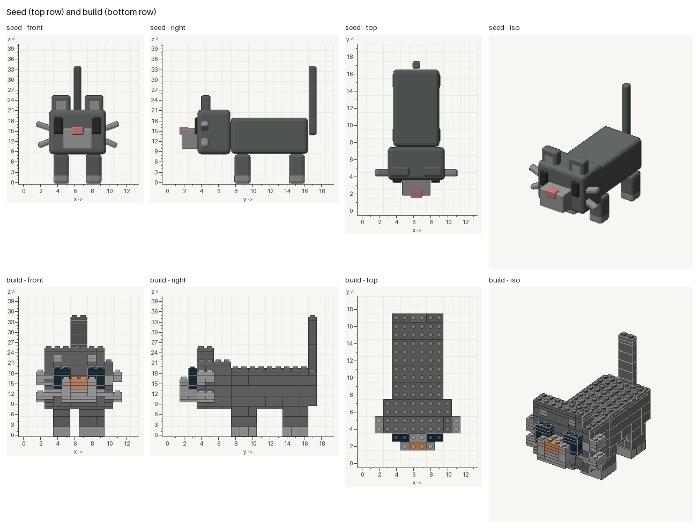
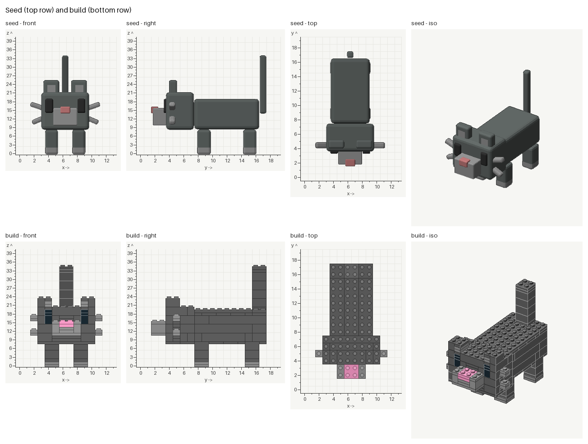
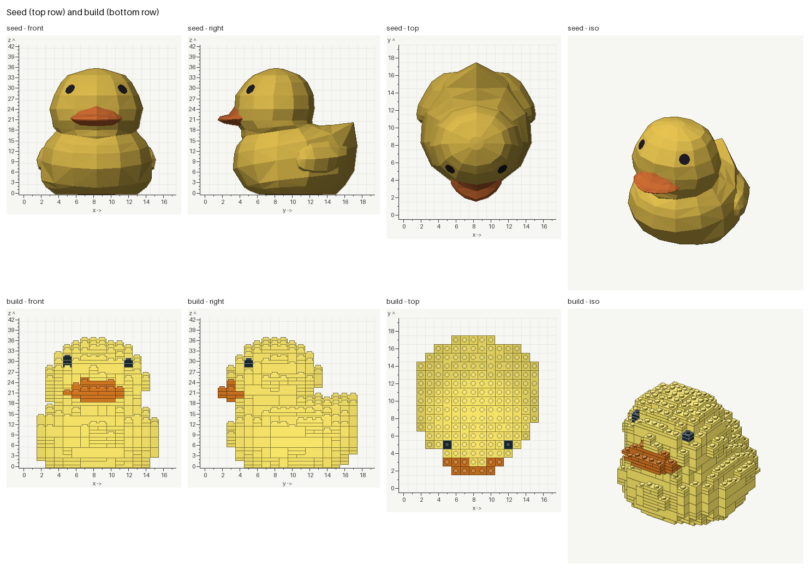
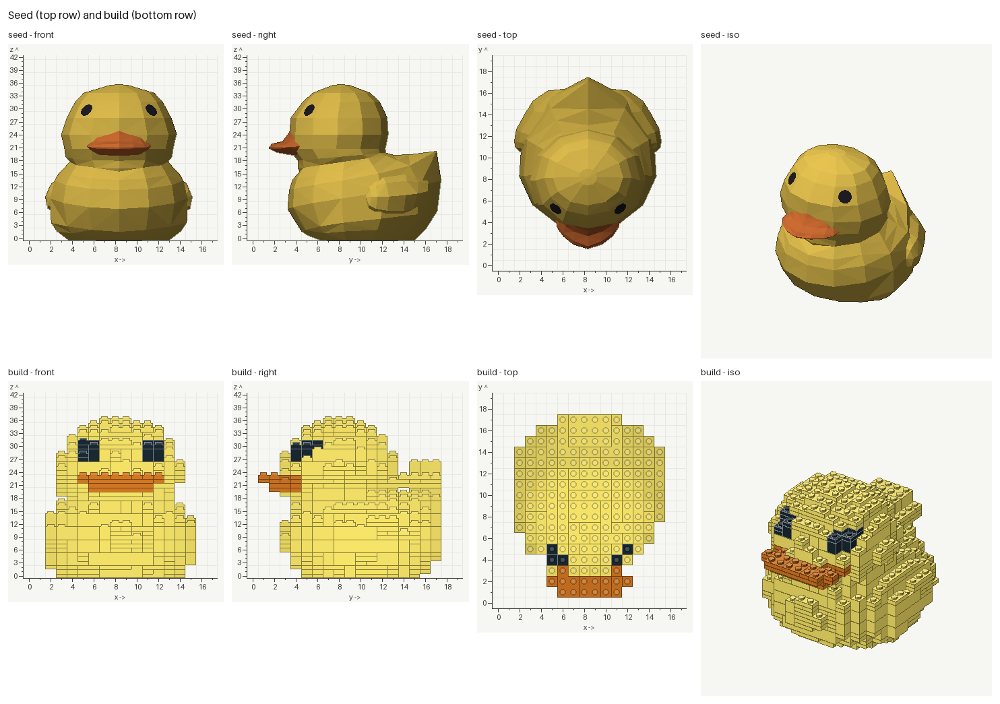

# Stage 1 is done: model in, valid real-brick file out, and the AI loop alive

Closed on 2026-11-15 by the lead's agent. This page shows the stage's "done when" from `docs/ROADMAP.md`,
point by point.

## Pawn, box, cylinder, and sphere build with zero loose bricks, solid and hollow, at three sizes

`tests/test_acceptance.py` builds each of those shapes solid and hollow at three sizes and requires one
connected piece with no loose part; it also builds the pawn from its file end to end. It passes, along with
the rest of the suite (1,267 tests).

All eleven sample models in `samples/models/` also build as one connected piece that stands, each in under
a second at 16 studs:

| Model | Parts | Colours | Result |
|---|---|---|---|
| bottle | 120 | 2 | valid, no loose parts |
| car | 406 | 10 | valid, no loose parts |
| cat | 183 | 4 | valid, no loose parts |
| duck | 550 | 3 | valid, no loose parts |
| hat | 253 | 2 | valid, no loose parts |
| knight | 424 | 6 | valid, no loose parts |
| pawn | 294 | 1 | valid, no loose parts |
| pineapple | 246 | 4 | valid, no loose parts |
| spaceship | 250 | 3 | valid, no loose parts |
| star | 162 | 1 | valid, no loose parts |
| teapot | 226 | 1 | valid, no loose parts |

For comparison, the prototype's method left 840 of 920 bricks unattached on a solid 20 x 20 x 20 box.

## A flat (zero-height) model is rejected with a message

The prototype hung forever on such a file. The engine now answers at once:

> The model in flat.stl is flat: it has no thickness from top to bottom, so it cannot be built from bricks.
> Give it some thickness in your 3D program, or check that the file holds the whole model, and try again.

## The AI makes one visible, valid change to a model through the clean-room runner

Two real runs of `uv run bricksnap design`, each about two minutes, on the lead's Claude Code subscription
with no API key. In each picture the top row is the 3D model and the bottom row is the brick build.

**Cat**, before (the plain conversion, 183 parts) and after (130 parts, valid). The designer rebuilt it
from clean shapes, made the ears, eyes, and tail readable, changed the nose to pink to match the model,
and continued each feature's colour into the head so that it is held from inside.

**Duck**, before (the plain conversion) and after (517 parts, valid). The designer kept the converted head and body,
replaced the ragged bill with a clean one that juts forward, enlarged the eyes, and added a tail. Its own
closing note says what stage 2 is for: "with slope parts, the bill, the top of the head and the tail could
be smooth curves instead of steps."

**The clean-room check** (`uv run python -m bricksnap.designer.parity`) reports that the model received
our prompt and exactly our four tools. What Claude Code still adds, and no documented setting removes, is
listed in "Running it clean" in `docs/ARCHITECTURE.md`.

## What a person still needs to look at

Opening `samples/projects/pawn/build.ldr` in BrickLink Studio, which does not run on Linux. See
`docs/tasks/check-ldraw-file-in-studio.md`.

## What we learned that shapes stage 2

- The conversion is faithful but reads as a staircase. Slopes and tiles are the biggest missing piece.
- A feature in its own colour stuck on a surface comes loose, because a part has one colour and parts hold
  only vertically. The designer learned to continue the colour into the body by hand; the make-buildable
  pass will do that automatically, in cells nobody can see.
- The designer decides well what matters but keeps its reasoning to itself. The brief becomes a tool call,
  so the decisions are written down and shown.
- Curved models need many small plates (the duck has about 550 parts at 16 studs). The scorecard will track
  part counts so that we can see what brings them down.
