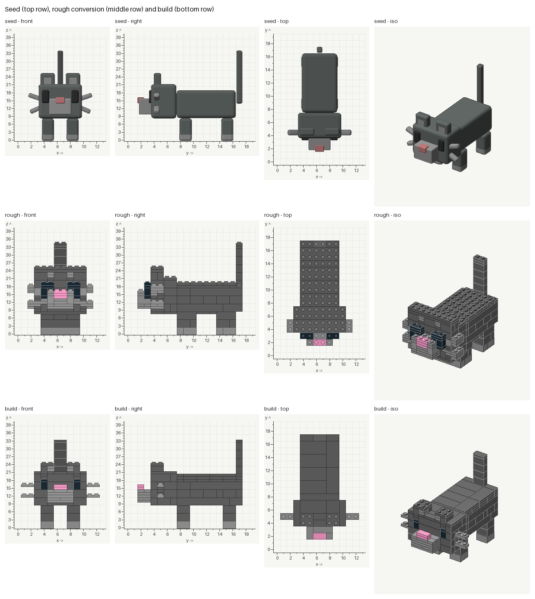
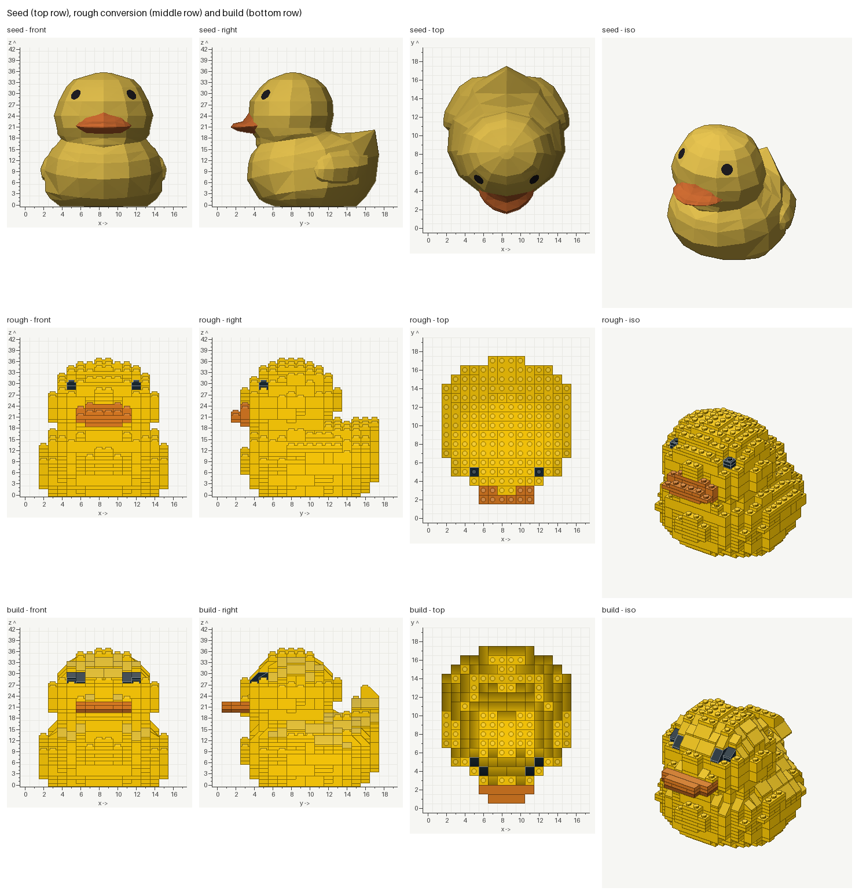

# Stage 2 is done: looks designed

Closed on 2026-11-15 by the lead's agent. The stage's "done when" in `docs/ROADMAP.md`: a cat 12 to 16
studs long, rough build and designed build side by side, clearly different, both valid.

## The cat, rough and designed

Top row: the 3D model. Middle row: the plain conversion (174 parts). Bottom row: the designed build (124
parts). Both pass every check as one connected piece that stands. This is one real run of
`uv run bricksnap design`, about two minutes, on the lead's Claude Code subscription.

What happened in that run, in order:

1. **The designer wrote its brief first**, because its edit tool now refuses to run without one: "A
   blocky, Minecraft-style grey cat standing on four legs ... The conversion merged the four legs into one
   solid block, smeared the face, and gave the body a ragged top ... rebuild it as clean boxes." The brief
   is saved in the project and shown to the person.
2. **It edited the design** in one call: separate legs, a clean body and head, ears, a muzzle with a pink
   nose, eyes, whiskers, a tail, and smooth finish marks on the body, head, muzzle, and tail.
3. **The software did the rest by itself and said so:** it recoloured 8 cells nobody can see so that the
   muzzle, nose, and whiskers are held from inside the head; it placed 20 tiles; and it kept studs on the
   8 whisker cells, explaining that "a tile there would let go of parts that are held on only through
   these cells".

The finished project is in `samples/projects/cat-designed/`, with its LDraw file, parts list (124 parts of
35 kinds), and BrickLink wanted list.

## The duck: slopes

Same three rows. The conversion marks where the model's own surface is slanted, and the finishing pass
puts slope parts there, so even with no designer the staircase is gone. In this run the designer kept the
converted head and body, rebuilt the bill, enlarged the eyes, and raised the tail; the result has 97 slope
parts and 633 parts in all, valid.

## What was built

| Piece | What it does |
|---|---|
| Finishing pass | Tiles where a top is marked smooth; 45-degree and cheese slopes where a sloped top steps down; detail parts stood on studs. A swap that would loosen anything is not made, and the notes say why and where |
| Make-buildable pass | Finds what the solver cannot attach and repairs it: first by recolouring cells nobody can see, then by thickening a thin sheet, then with a support. Works on a copy; the saved design is untouched |
| Slope marks | The conversion marks cells whose surface in the model is slanted between 20 and 70 degrees |
| Centring | A model is centred on the stud grid, so a symmetric model gives a symmetric build |
| Colour matching | By how colours look (see the decision record), which also cut part counts |
| New edits | `set_finish`, `place_detail`, `remove_detail`, and `"mirror": true` on any edit |
| The brief | A fifth designer tool; nothing can be edited until it is written |
| Real shapes | Slopes, tiles, round parts, and cones are drawn as themselves in the pictures and the 3D viewer |
| Exports | `parts.csv` and `wanted_list.xml` in BrickLink's upload format |
| The scorecard | `uv run bricksnap bench` builds every test model and measures it |

Every piece was written by one agent, reviewed by another against a written contract, and fixed. The test
suite has 2,125 tests.

## The scorecard today

Saved as `samples/scorecard.json`. All eleven models build with no loose parts at 16 studs.

| Measure | Rough | Finished |
|---|---|---|
| Parts, all eleven models | 3,102 | 3,570 |
| Upward surface that is tiles or slopes, not studs | 0% | 34% |
| Outline match with the model (front, right, top) | | 81%, 83%, 78% |
| Weak spots | | 237 |

## What a person still needs to do

- Open `samples/projects/pawn/build.ldr` and `samples/projects/cat-designed/build.ldr` in BrickLink Studio
  (`docs/tasks/check-ldraw-file-in-studio.md`).
- Upload `samples/projects/cat-designed/wanted_list.xml` on BrickLink's wanted-list page to confirm that
  no item is rejected. It needs a BrickLink account; nothing is bought by uploading.

## What we learned that shapes stage 3

- **The conversion is fat.** It fills every cell the model touches, so the cat's legs merge and outlines
  match only about 81%. Filling by coverage instead was built and raises that to 87% with a fifth fewer
  parts, but thin features then come loose. It waits on a branch (`docs/tasks/fill-cells-by-coverage.md`).
- **Valid is not the same as sturdy.** In the designed cat the head hangs on one brick
  (`docs/tasks/fewer-weak-spots-across-seams.md`).
- **Finishing costs parts.** A brick that gets a tile becomes two plates and a tile
  (`docs/tasks/fewer-parts-on-curved-models.md`).
- **Eyes belong on the front of a face**, which needs parts turned on their side
  (`docs/tasks/side-stud-details.md`).
