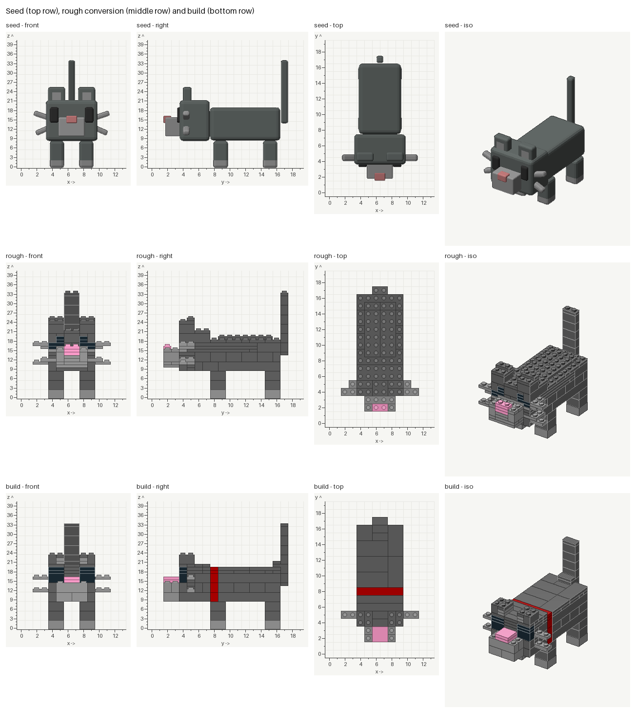
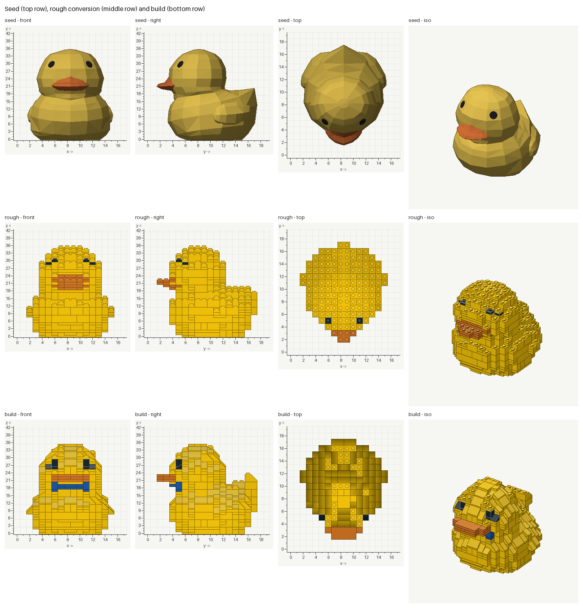
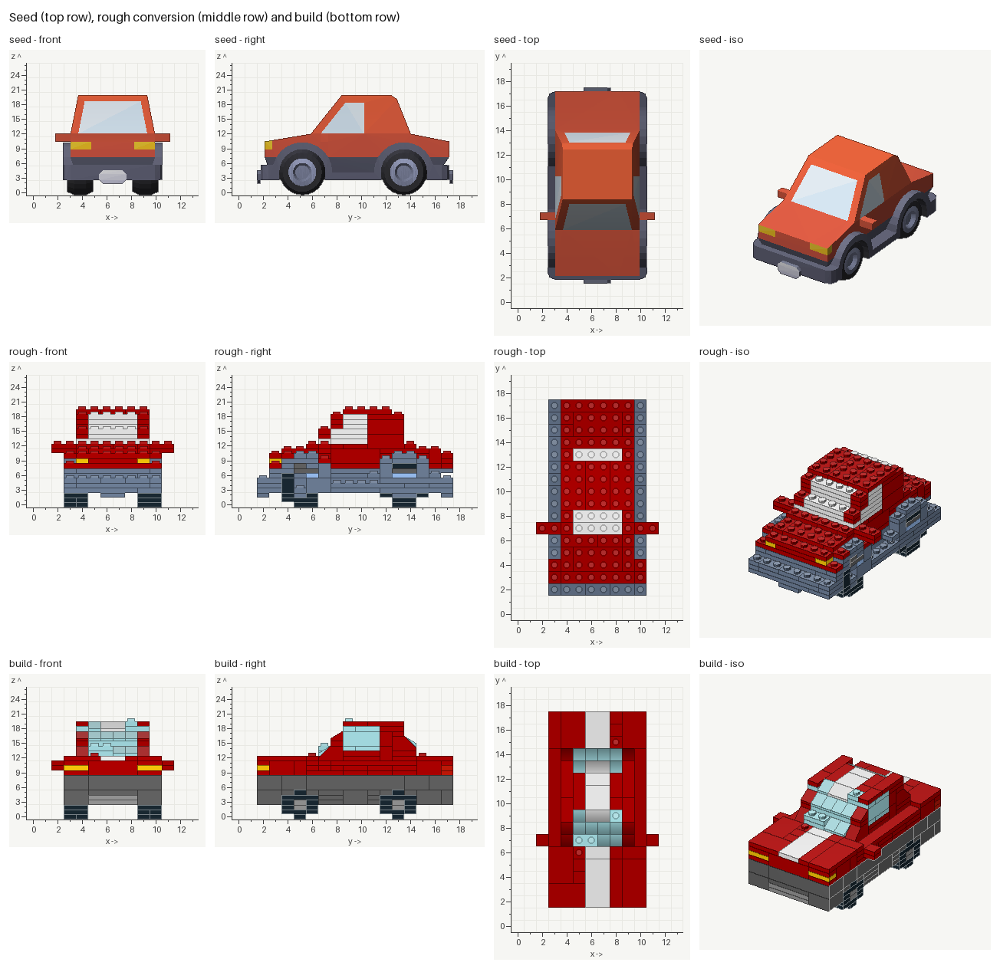
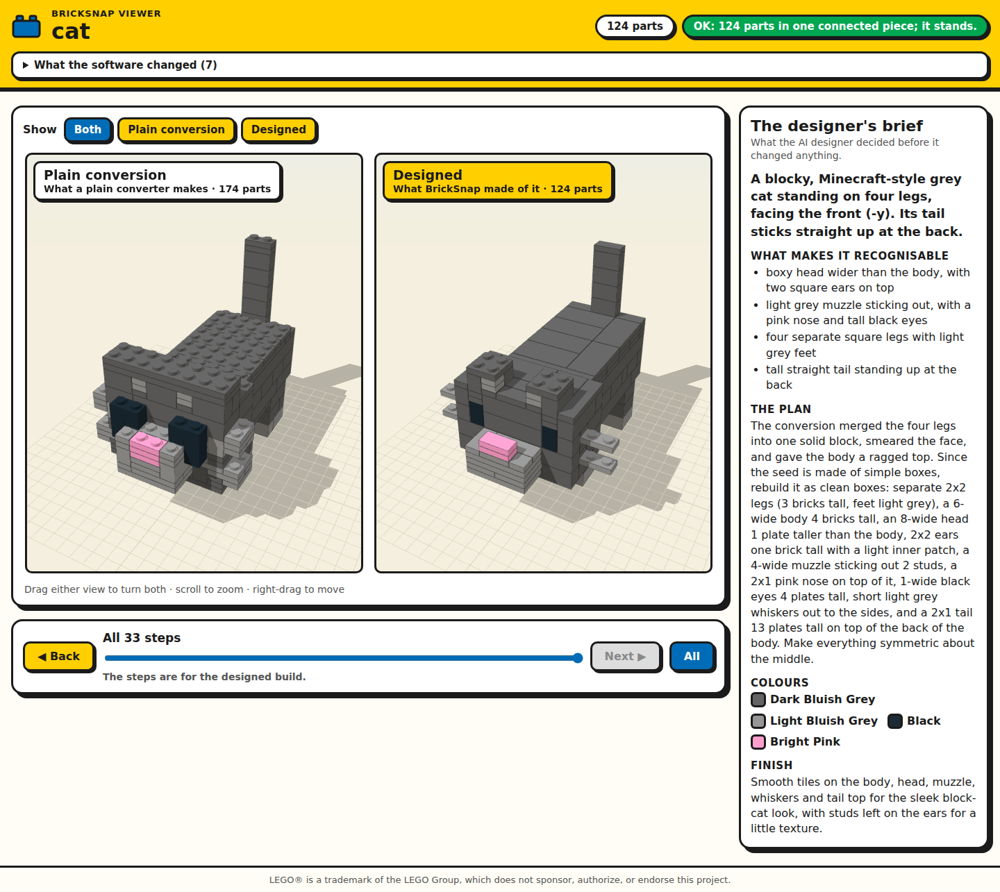
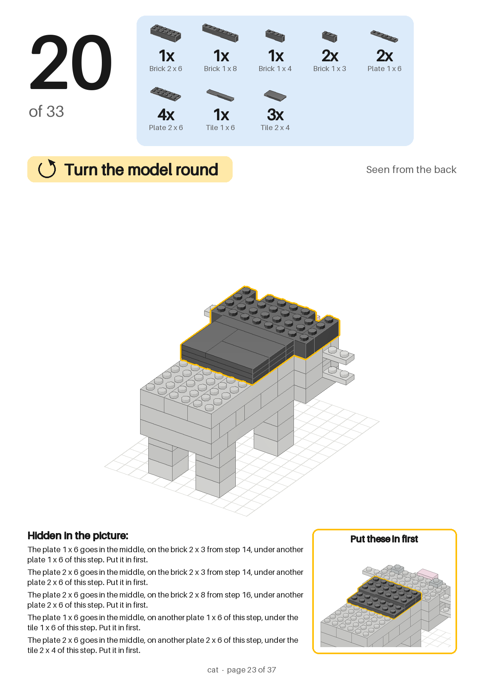
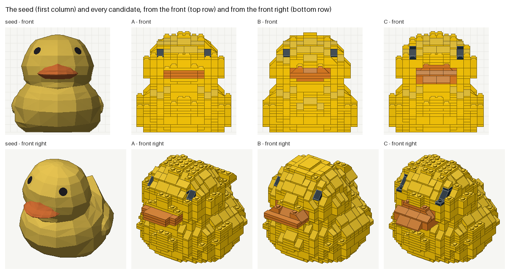

# Stage 3 is done: steerable and showable

Closed on 2026-11-17 by the lead's agent. The stage's "done when" in `docs/ROADMAP.md`: three showcase
models run from seed to finished set, including a typed edit.

## Three models, from a model file to a finished set

Each went through the same commands, with no hand editing: `new` (convert and build), `design` (the AI
designer's first pass), `design "<a change>"` (one typed edit), `export` (LDraw file, parts list, wanted
list), and `instructions` (the booklet). All three finished builds pass every check. Top row: the 3D
model. Middle row: the plain conversion. Bottom row: the finished build.

**Cat**: 116 parts, 29 steps. Typed edit: "add a red collar".

**Duck**: 530 parts, 82 steps. Typed edit: "give it a little blue bow tie".

**Car**: 244 parts, 45 steps. Typed edit: "paint a white racing stripe along the top, from the bonnet
to the boot". The designer chose a transparent light blue for the glass by itself.

The three finished projects are in `samples/projects/` (`cat-showcase`, `duck-showcase`, `car-showcase`),
each with its brief, parts list, and wanted list; the cat's instruction booklet is there too.

## What was built in this stage

| Piece | What it does |
|---|---|
| Typed edits | `design PROJECT "add a red collar"` makes that change and nothing else, and says what it did. Checked on real runs: only the cells the request concerns change |
| Blind judge | `design PROJECT --best-of 3` designs three times; a second AI session that cannot tell which is which keeps the best. On the duck it chose the design a person would, where measurement alone would not have |
| Before-and-after viewer | The 3D viewer shows the plain conversion beside the designed build, turning together, with the designer's brief |
| Instruction booklet | `instructions PROJECT` writes a PDF and a web page: the parts, then one page per step, turned round when the new parts are at the back |
| Truer shapes | The conversion fills a cell when the model fills most of it. Outline match with the model went from about 81% to 87%, with a fifth fewer parts |
| Sturdier builds | The solver ties sections together with more than one part, the finishing pass may not undo that, and the make-buildable pass cures sections that hang by a thread |

A page of the cat's booklet, and the sheet the judge saw for the duck:

## Checked outside our own code

- **LeoCAD** (an independent free program) opens our files and draws them as our own pictures do, slopes
  facing the right way, and reads our building steps.
- **BrickLink Studio**: Alec opened the designed cat in Studio 2.26.10. It looks right, and Studio's
  instruction maker shows all its steps. Our colour numbers and part numbers match Studio's own tables,
  with one exception written in `docs/tasks/check-ldraw-file-in-studio.md`.

## The scorecard today

Saved as `samples/scorecard.json`. Every sample model builds with no loose parts at 12, 16, and 24 studs.

| Measure, eleven models at 16 studs | End of stage 2 | Now |
|---|---|---|
| Outline match with the model (front, right, top) | 81%, 83%, 78% | 87%, 87%, 87% |
| Parts | 3,570 | 2,809 |
| Upward surface that is tiles or slopes | 34% | 38% |
| Weak spots (a section hanging on one part or stud) | 237 | 232 |

The largest section hanging on a single part is now 36 cells. At the end of stage 2 the designed cat's
whole head, 92 parts, hung on one brick.

## What a person still needs to do

- Read the cat's booklet page by page (`samples/projects/cat-showcase/instructions.pdf`): could you build
  it from that alone?
- Say whether you agree with the judge on the duck (`docs/stages/stage-3/judge-sheet-duck.png`: it ranked
  B, then A, then C).
- In Studio: open the pawn and a duck, run Studio's collision and stability checks, and run Studio's own
  converter on the cat, duck, and car so we can show the two side by side
  (`docs/tasks/check-ldraw-file-in-studio.md`).
- Bring a third showcase model of your own: a scan, a CAD part, or a logo
  (`docs/tasks/choose-showcase-models.md`). The car stands in for it here.

## Carried into stage 4

- Details on the side of a model, so eyes can be round tiles on the front of a face
  (`docs/tasks/side-stud-details.md`).
- Weak spots that remain in thin models at larger sizes (`docs/tasks/weak-spots-in-thin-models.md`).
- Fewer small plates on curved models (`docs/tasks/fewer-parts-on-curved-models.md`).
- The test suite has grown to about fourteen minutes; it needs to be quick again.
